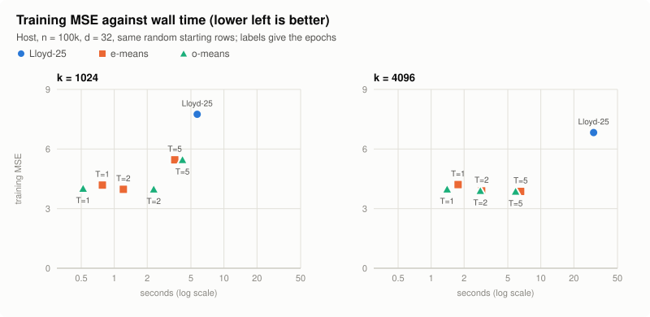
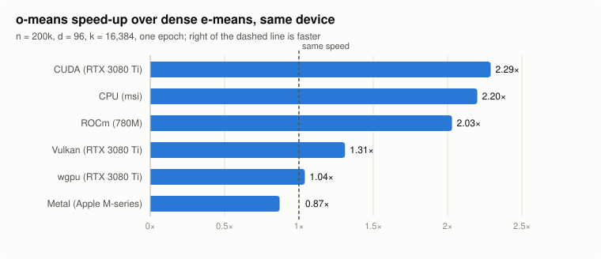

# rlx-vq

Fused vector-quantization kernel for RLX — nearest-codebook assignment
(`cdist → argmin`) that beats the `matmul + argmin` composition.
**Downstream package**: registers against rlx's custom-op scaffold
without touching `rlx-ir`, `rlx-opt`, or `rlx-runtime` core.

## What's here

- **`vector_quantize(g, x, codebook, metric, target)`** — nearest-codebook
  assignment. Returns `(indices, quantized)`. The fused CPU path computes
  `argmin_j (‖C_j‖² − 2·x·C_jᵀ)` with a running per-row reduction — it never
  materializes the `[N, K]` distance matrix and parallelizes over rows.
- **`Metric`** — `L2` (squared Euclidean) nearest-codebook distance.
- **`Target`** — device-aware lowering (see below).
- **`register()`** — call once per process to publish `Op::Custom("rlx.vq_assign")`
  via the framework kernel registries (`OpExtension` + CPU / Metal kernels).

## Device-aware lowering (`Target`)

VQ's core is a matmul, so the fastest implementation differs by backend:

- **`Target::Cpu`** → the fused custom op (no `[N,K]` matrix, rayon over rows).
  Measured **1.5–5.4×** faster than the `matmul + argmin` composition, the win
  growing with codebook size `K`.
- **`Target::Gpu`** → the on-device composition (MPS matmul + argmin). On Metal
  the matrix units make this **~10×** faster than the CPU path, so it is the
  right choice on Metal / wgpu.

`rlx-metal` additionally recognizes `Op::Custom("rlx.vq_assign")` and dispatches
a native on-GPU MSL kernel (one threadgroup / row, `float4` cooperative argmin),
so a `Target::Cpu` graph accidentally run on Metal is only ~2–4× slower than the
composition rather than ~100× of a host-callback ABI.

## Features

- `cpu` *(default)* — registers the fused `CpuKernel`.
- `metal` — registers the Metal host-callback `MetalKernel` (macOS only); the
  native MSL kernel in `rlx-metal` is preferred when available.
- `emeans` — the e-means trainer (`rlx_vq::emeans`, see below).
- `emeans-device` — adds the device-resident trainer (`emeans::device`;
  depends on `rlx-runtime`).
- `omeans` — the o-means trainer (`rlx_vq::omeans`, see below).
- `omeans-device` — adds the device trainer (`omeans::device`).

## Install

```toml
[dependencies]
rlx-vq = "0.2"
```

## Quickstart

```rust
rlx_vq::register();   // once per process

let (idx, q) = rlx_vq::vector_quantize(
    &mut g, x, codebook, rlx_vq::Metric::L2, rlx_vq::Target::Gpu,
);
```

## Results: k-means, e-means, o-means

All three from the same random starting rows, on skewed Gaussian blobs
(`tests/omeans.rs`; the charts come from `scripts/readme_charts.py`).

**Host, n = 100k, d = 32** (`bench_kmeans_emeans_omeans`). Lloyd runs 25
full passes; e-means and o-means run T epochs. o-means uses its default cells:
at k = 1024 that is 16 cells, all probed, so only the closing mean differs from
e-means; at k = 4096 rows probe 16 of 32 cells.



| k | method | T | training MSE | vs Lloyd-25 | time |
|---|---|---|---|---|---|
| 1024 | Lloyd | 25 iterations | 7.7478 | — | 5.70 s |
| 1024 | e-means | 1 | 4.1831 | −46.0% | 0.78 s |
| 1024 | o-means | 1 | 4.0131 | −48.2% | 0.52 s |
| 1024 | e-means | 2 | 3.9736 | −48.7% | 1.21 s |
| 1024 | o-means | 2 | 3.9736 | −48.7% | 2.29 s |
| 1024 | e-means | 5 | 5.4566 | −29.6% | 3.56 s |
| 1024 | o-means | 5 | 5.4566 | −29.6% | 4.19 s |
| 4096 | Lloyd | 25 iterations | 6.8297 | — | 30.27 s |
| 4096 | e-means | 1 | 4.2086 | −38.4% | 1.76 s |
| 4096 | o-means | 1 | 3.9748 | −41.8% | 1.40 s |
| 4096 | e-means | 2 | 3.8965 | −43.0% | 2.89 s |
| 4096 | o-means | 2 | 3.8996 | −42.9% | 2.81 s |
| 4096 | e-means | 5 | 3.8652 | −43.4% | 6.55 s |
| 4096 | o-means | 5 | 3.8632 | −43.4% | 5.89 s |

- Lloyd keeps the regions its random rows left empty or doubled; e-means'
  revival splits busy clusters into dead ones, which is most of the gap on
  these blobs.
- At k = 1024 five epochs ended above two (5.46 vs 3.97), identically in
  both trainers. The throughput law's batch grows with T (B ∝ T^0.81); the
  cause of this regression is not traced yet.
- o-means' one-epoch gain is its recency-weighted closing mean; from two
  epochs it closes as e-means does and lands within 0.1%.
- On the playground generators (`tests/emeans_playground.rs`), 5 e-means
  epochs beat 25 Lloyd iterations on held-out rows on 22 of 24 datasets at the
  default size (median ratio 0.982) and on 24 of 24 at the page's size.

**Device, n = 200k, d = 96, k = 16,384, one epoch** (`bench_large_k`):
dense device e-means against device o-means (`DeviceOmeans`), each on the
same backend.



| device | e-means | o-means | speed-up |
|---|---|---|---|
| CUDA (RTX 3080 Ti) | 22.05 s | 9.63 s | 2.29× |
| CPU (msi) | 9.75 s | 4.43 s | 2.20× |
| ROCm (780M) | 25.64 s | 12.66 s | 2.03× |
| Vulkan (RTX 3080 Ti) | 26.20 s | 19.99 s | 1.31× |
| wgpu (RTX 3080 Ti) | 4.94 s | 4.74 s | 1.04× |
| Metal (Apple M-series) | 0.83 s | 0.96 s | 0.87× |

o-means' tiles do 26% of a dense pass's products here. Where the backend's
dense GEMM is far faster than its gathers and reductions (Metal, wgpu), that
saving does not yet pay for them. o-means' error was 53–57% lower in every
run; that is this benchmark's regime of about 12 rows per centroid in one
epoch, where e-means' closing mean averages rows labelled against the early,
near-random centroids. The reference reports 0.34–0.70% at one epoch on real
embeddings.

## e-means (`emeans` feature)

`rlx_vq::emeans` implements **e-means**, the mini-batch k-means of

> S. Bessa, P.-E. Mazaré, G. Szilvasy, H. Touvron, D. Picard, M. Douze and
> H. Jégou, *e-means: outperforming k-means (in one-tenth the epochs)*,
> arXiv:2611.09501, 2026. <https://arxiv.org/abs/2611.09501>

Each batch updates every cluster's mass `N_j` and position `c_j` with an
exponential moving average (`N ← γN + αn`, `c ← c + (αn/N)(s/n − c)`), with
`α` cosine-annealed to `0.1·α₀`, dead clusters revived by splitting
mass-weighted donors every 5 steps, and exact closing means over the last
epoch. Batch size and `α₀` come from the paper's fitted scaling laws, so the
epoch budget is the only setting.

```rust
use rlx_vq::emeans::{Emeans, EmeansConfig};

let mut em = Emeans::new(d, k, EmeansConfig::default()); // 5 epochs
let (centroids, labels) = em.train(&x, None);           // x: [n, d] f32
let (dist, nearest) = em.assign(&x_new);
```

- **Host trainer** (`Emeans`) — fused nearest-centroid search (rayon, no
  `[B, k]` matrix) plus the EMA, revival and closing on the host. It follows
  faiss's `contrib/e_means` `NumpyEmeans` step for step, including its NumPy
  MT19937 streams via `rlx-rng`: on the same data and seed the per-epoch
  objectives agree to 6 digits, and at `d = 8` the centroids and labels are
  bit-identical. `scripts/emeans_faiss_reference.py` runs that comparison.
- **Step graph** (`step_graph`, `step_graph_with`) — one step as an rlx graph
  (matmul → ArgMin → ScatterAdd of `[x | 1]` → EMA), so any backend runs it;
  `Emeans::update_from_step` advances the schedule from its outputs.
  `step_graph_with` runs the assignment in f64, f16 or bf16. The assignment
  centres rows and centroids on the batch mean first: the argmin is the
  same, but far from the origin `‖c‖²` and `x·c` swamp the gaps between
  centroids, so f16 overflowed and an XDNA bf16 matmul labelled 8% of rows
  right at offset 300.
- **Initialization** — `EmeansConfig::init` is `Init::RandomRows` (the
  reference's, and the default) or `Init::KMeansPlusPlus`. Random rows can
  leave a well-separated region without a centroid, which revival does not
  repair (seed 1 on 20 blobs ends at 4.8× the MSE of other seeds, in faiss
  too). Over 5 seeds on 4 blob sets, k-means++ lowered the mean MSE 5–37% and
  the worst case up to 74%, for `O(32·k²·d)` seeding (29 ms at k = 256,
  d = 32).
- **Device-resident trainer** (`emeans::device::DeviceEmeans`, feature
  `emeans-device`) — the dataset, centroids, masses and epoch accumulators
  live in GPU handles that the step graph feeds in place; a step uploads only
  its row indices, row weights and `α` and reads nothing back. The host reads
  the `k` masses every 5 steps for revival (with the host trainer's RNG, so
  the same clusters split), and the accumulators once per epoch. Resident on
  CPU, Metal, MLX, wgpu, Vulkan, CUDA and ROCm; elsewhere the same graph runs
  with the state passed through. On the XDNA NPU, `device_options` picks the
  bf16 matmul over the default INT8.

  ```rust
  use rlx_vq::emeans::{EmeansConfig, device::DeviceEmeans};
  let mut em = DeviceEmeans::new(rlx_runtime::Device::Metal, d, k, EmeansConfig::default());
  let (centroids, labels) = em.train(&x, None);
  ```
- **Playground datasets** — `tests/emeans_playground.rs` ports the 24
  generators of the paper's [browser playground](https://e-means.github.io/playground.html)
  (all but the Meta logo) and races 5 e-means epochs against 25 Lloyd
  iterations on held-out rows, as the page does, plus the device trainer with
  the page's bf16 assignment on every backend. At the page's size
  (`EMEANS_PLAYGROUND_N=100000 EMEANS_PLAYGROUND_K=500`) e-means wins 24/24.
- **Parity** — `tests/emeans.rs` runs the step graph and a full graph-driven
  run on every available backend at every precision (`CompileOptions::
  number_format` f64/f64x2/f32/f16/bf16/f8, plus native casts), each case in
  its own process. Enable backends through `rlx-runtime` features:

  ```sh
  cargo test -p rlx-vq --release --test emeans \
      --features emeans,metal,rlx-runtime/vulkan,rlx-runtime/coreml -- --nocapture
  cargo test -p rlx-vq --release --test emeans \
      --features emeans,rlx-runtime/cuda,rlx-runtime/rocm,rlx-runtime/xdna -- --nocapture
  ```

  `RLX_REQUIRE_DEVICE=1` turns unsupported combinations into failures.

## o-means (`omeans` feature)

`rlx_vq::omeans` implements **o-means** (Bajaj, Nupur and Garg, *o-means:
index the centroids, don't scan them*, Owlgebra AI 2026,
<https://owlgebra.ai/blog/o-means/>; reference code in
[owlgebra-ai/faiss `contrib/o_means`](https://github.com/owlgebra-ai/faiss/tree/main/contrib/o_means)).
It is e-means' training loop with three changes:

- **Two-level assignment.** The centroids are grouped into `nlist` cells of
  about 128 by k-means on the centroids (`CentroidIndex`); a row is scored
  against the cell centres, then only against the centroids of its `nprobe`
  nearest cells.
- **Cells kept current.** During the first pass the centroids are re-filed
  every 5 steps, after it the cells are refit every half pass, and every
  split links the donor to its child, which rows of the donor also score.
- **Recency-weighted closing below 2 epochs**: each batch weighs
  `exp(−r/n)`, `r` the rows processed after it.

```rust
use rlx_vq::omeans::{Omeans, OmeansConfig};

let mut om = Omeans::new(d, k, OmeansConfig::default());
let (centroids, labels) = om.train(&x, None);
```

`OmeansConfig` wraps `EmeansConfig` (epochs, seed, `Init`, ...) plus
`nlist`/`nprobe` (defaults: `k/128` rounded up to a multiple of 16; 16 probes,
12 at `d ≥ 512`, 24 above `k = 16384`). Its `BatchLaw::Auto` picks the
throughput law up to 2M rows, as the reference does.

- **Host trainer** — probing every cell with revival off reproduces `Emeans`
  bit for bit. Probing 6 of 64 cells (`k = 1024`) used 22% of the distance
  evaluations; the error was 3.5% lower at one epoch (the recency close) and
  equal at two.
- **Device trainer** (`omeans::device::DeviceOmeans`, feature
  `omeans-device`) — every per-row computation runs in rlx graphs over
  device-resident state: probes for all rows (`TopK`, recomputed only when
  the cell centres move), the cell filing, and one step graph that cuts each
  probed cell into tiles of 128 rows × 64 centroids, runs them as one batched
  matmul, reduces each row over its tiles, checks the split links, and applies
  e-means' statistics and EMA. The host builds tile index arrays from the
  probes and reads the masses every 5 steps. Matmuls are strict FP32
  (`omeans_options`): CUDA's TF32 picked a farther centroid for 3 of 540 rows.
  `tests/omeans.rs` checks one step against an exact f64 two-level search on
  every backend (CPU, Metal, MLX, CoreML, wgpu, Vulkan, CUDA, ROCm, XDNA), at
  16 and 2323 tiles.

  Timing against dense device e-means is under
  [Results](#results-k-means-e-means-o-means).

## License

MIT OR Apache-2.0.
