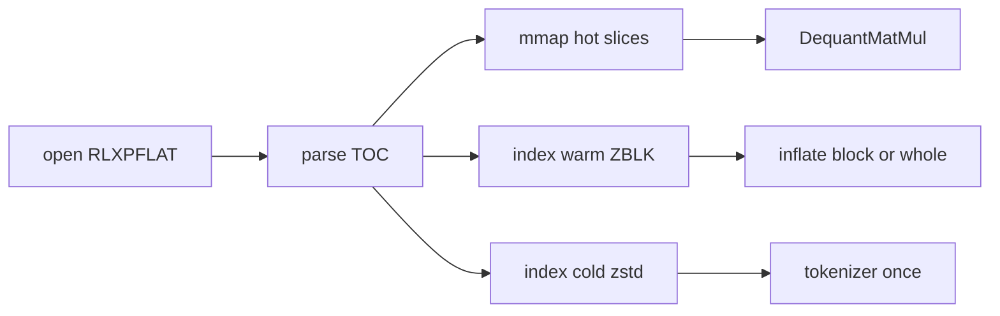

# RLX Package Format (`.rlxp`)

Single-file **flat mmap** package (default), with optional ZIP or directory
layouts for inspectability / editing. Supports a **hybrid hot / warm / cold**
data plane: mmap active weights, block-zstd for rarely used tensors, whole-blob
zstd for sidecars.

Bake’s `RLXBAKE1` (`*.rlx`) remains supported; export into `.rlxp` for deployment.

Crate: [`crates/io/rlx-pkg`](../crates/io/rlx-pkg/).

## Why flat beats the alternatives

| Format | Load | Size (quantized LLM) | Notes |
|--------|------|----------------------|--------|
| **RLXP flat** | One `mmap`, tiny JSON TOC | GGUF-class packed weights, **no duplex**, no ZIP headers | MIR + hybrid cold/warm |
| GGUF | One `mmap` | Excellent packed quants | Weights + metadata; no portable MIR graph |
| safetensors | One `mmap` | Usually f16/bf16/f32 | No GGUF-class block quants |
| DDUF | ZIP + member seek | safetensors + ZIP overhead | Import via `rlx-pkg import-dduf` / [`docs/dduf.md`](dduf.md) |
| MLX | dir / safetensors / npz | Dense + affine/mxfp packs | Import via `rlx-pkg import-mlx` / [`docs/mlx-weights.md`](mlx-weights.md) |
| NeMo | `.nemo` tar + torch ckpt | Dense f32 | `rlx-pkg import-nemo` |
| PyTorch | `.pt` / `.pth` / `bin` | Dense f32 | `rlx-pkg import-pt` |
| ONNX | Protobuf parse | Often dense floats + graph | Graph-heavy; not mmap-first for weights |

## Hybrid tiers

| Tier | Codec | Access API | Use for |
|------|-------|------------|---------|
| **Hot** | `none` (raw) | `tensor_mmap` / `tensor_bytes` | Active GEMM / dequant weights, graph, placement |
| **Warm** | `zstd_blocks` (`ZBLK` header + per-block zstd) | `tensor_bytes`, `tensor_warm_block(i)` | Idle experts, other-rank shards, large rarely touched blobs |
| **Cold** | `zstd` (one frame) | `sidecar` / decode on read | Tokenizer, chat template, license, bake report |



Default write policy for flat packs:

- Weights default **hot** (set `PackedWeight.tier`, or `apply_auto_tier`)
- Sidecars **cold zstd** (`WriteOptions.compress_sidecars`, default true)
- Graph + placement stay **hot/raw** (unless `include_graph = false`)
- Warm block size default **1 MiB** (`warm_block_size`)
- xxh3 checksums on by default (`write_checksums`); string interning on by default

Warm on-disk blob (`ZBLK`):

```
magic "ZBLK"
u32 block_size
u64 raw_length
u32 n_blocks
repeat n_blocks:
  u32 comp_len
  [comp_len bytes of one zstd frame]
```

## Containers

| Kind | When | Magic / shape |
|------|------|----------------|
| **Flat** (default `.rlxp`) | Ship / serve | `RLXPFLAT` + TOC + 64-byte-aligned data |
| **ZIP** (`.zip` or `--container zip`) | Human inspect (`unzip -l`) | ZIP64 STORE; **hybrid codecs supported** in shard bytes |
| **Dir** | Dev edit | Tree with `rlx.json`; hybrid codecs in shard |

### Flat layout

```
[0..8)   magic "RLXPFLAT"
[8..12)  container_version u32 LE (=2 for hybrid)
[12..16) flags u32 LE (bit0 = FLAG_HYBRID, bit1 = FLAG_BINCODE_TOC)
[16..24) toc_len u64 LE
[24..24+toc_len)  JSON or bincode FlatToc
[pad to 64-byte alignment]
[data)   graph | tensors | sidecars | placement
```

Each TOC tensor/sidecar row includes `tier`, `codec`, `offset`, `length`,
optional `raw_length`, and optional xxh3 `checksum`. Weight bytes appear
**once**; graph `Constant` payloads are cleared on write and filled on
`Package::graph()` (**hot tier only** by default — warm/cold bind via
`bind_tensor` / `bind_warm_and_cold`).

Optional TOC features:

- **String table** (`strings` + `name_i`) — `WriteOptions.intern_strings`
- **Bincode TOC** — `WriteOptions.bincode_toc` + `FLAG_BINCODE_TOC`
- **Weight-only** — `include_graph = false` → `graph.encoding = "none"`

## Warm is not a quant

Warm `zstd_blocks` shrinks **rarely touched host blobs**. It does **not**
replace GGUF-class block quants (`Q4_K`, …). For LLM weights, pack as
`gguf_q4_k` (or similar) on the **hot** tier; use warm for idle experts /
other-rank shards / large spare tensors. Compare size against GGUF with
the `q4k_compare` bench — not against warm zstd of f32.

## Compat policy

| Field | Rule |
|-------|------|
| `format` | Must be `"rlxp"` |
| `format_version` | Loader rejects if newer than crate `FORMAT_VERSION` |
| `compat_version` | Package may require up to crate `COMPAT_VERSION` |
| `features` | Advisory + capability gates (`hybrid_storage`, `toc_bincode`, …) |
| `FLAT_CONTAINER_VERSION` | v1 packs load (tiers default hot/none); v2 = hybrid |
| `graph.encoding` | `rlxmodel_v1` (written), `bincode_graph_v1` (older packages, read only) or `none` (weight-only) |

Readers must ignore unknown TOC fields (serde `deny_unknown_fields` is
**not** used). Writers should bump `compat_version` only when old loaders
cannot safely skip new required behavior.

## Executable graph (optional)

Like ONNX, an `.rlxp` **may** embed a runnable MIR graph (`graph.encoding =
rlxmodel_v1`). The graph is stored as `.rlxmodel` text (`rlx_ir::rlxmodel`),
which names every op and field, so a package keeps reading after the `Op`
enum changes. In a directory pack it is `graph/model.rlxmodel`, readable and
editable. Packages written before it hold `bincode_graph_v1` (`graph/mir.bin`),
which still reads.

The graph member is a whole `.rlxmodel` module: the main graph first, any
other functions of the model after it (`WriteOptions::extra_graphs`,
`Package::module`), and a header with the versions and the model block:

```text
rlxmodel 1
opset 1
rlx 0.2.18                      // the rlx that wrote it
requires 0.2.18                 // optional: the oldest rlx that may read it
model {name: "multilingual-e5-base", version: "1.0.0", task: "embedding",
       weights: [{uri: "safetensors://model.safetensors", prefix: "roberta."}]}

graph @encode { … }
```

`weights` lets a package hold the model without its weights. Each param the
package does not embed comes from the first source that has it: the file's
tensor `map[param]`, else `prefix` + the param's name. Any
`rlx_runtime::dist::resolve_weight_uri` scheme works (`safetensors://`,
`gguf://`, `rlxp://`, `mlx://`, …), and a relative path is beside the package,
or inside a directory package. A param no source has fails the open. A `map`
entry is the file's tensor name, or `{tensor?, transpose: true}` for a 2-D
tensor stored the other way round (`tensor` defaults to the param's own
name).

The model block also says who made the model and under what terms, read by
`Module::{authors, licenses, repository, homepage, card, card_data}` and
reported in `Model.info().metadata`:

- `authors`, `repository` and `homepage`;
- `license`: SPDX, one or a list;
- `card`: the model card's Markdown body, kept verbatim as a `"""` block;
- `card_data`: its metadata. These are the YAML front-matter keys of a
  [Hugging Face model card](https://huggingface.co/docs/hub/model-cards),
  under Hugging Face's own names: `license` (or `other` with `license_name`
  and `license_link`), `language`, `library_name`, `pipeline_tag`, `tags`,
  `datasets`, `metrics`, `base_model`, `base_model_relation`, `new_version`,
  `model-index` (evaluation results), and so on.

An exporter reads a checkpoint's `README.md` into `card_data` and `card`
(`rlx_core::package_export::add_huggingface_card` in rlx-models).
`rlx_runtime::model::rlxp::huggingface_readme(model)` writes the card back as
a Hub `README.md`, to publish a package. Where `card_data` doesn't set them,
it fills in `license`, `pipeline_tag` (from `task`) and `library_name: rlx`.

### Reading a graph

```text
graph @step {
  %input_ids = input : i32[1, 1]
  %past_k_0 = input : f32[1, cap, 1024]
  %model.embed_tokens.weight = param : f32[151936, 1024]
  %2 = Gather{axis: 0} %model.embed_tokens.weight, %input_ids : f32[1, 1, 1024]
  …
  return %logits, %k_0, %v_0, …
}
```

A value's label is its node's name when that name is a label: it starts with
a letter or `_`, continues with letters, digits, `_` and `.`, and no other
node has it. Otherwise the label is the node's position (`%7`). An input or
param named like its value is `%x = input` / `%w = param`. An optional field
that is `none` is left out (`origin {hir: 3}`). Files with numbered values and
explicit `name "…"` (as written before) read the same.

**Constants** of up to 256 elements, in f32, f64, i8–i64, u8, u32 or bool,
are their values: `%zero = const 0.0 : f32[]`, `%iota = const [0, 1, 2, 3] :
f32[4]`. NaN bits, `-0.0` and `±inf` are kept. A larger, half-precision or
stripped constant stays `Constant{data: b64"…"}`.

**Output names** follow `as`: `return %lm_head as logits, %k_0 as
"present.0.key"` (quoted when not a label). The runtime finds an output by
its name (`CompiledGraph::output_index`); ONNX imports keep the model's own
output names.

**Variables** are inputs whose next value the graph returns, such as a
decode step's caches. `%past_k_0 = var : f32[1, cap, 1024]` declares one
(or a ` var` suffix, for an input not named like its value), and
`return %logits, %past_k_0 = %k_0` gives its next value. A caller feeds each
variable's output back as its input on the next call (`Graph::vars`), and a
`generate` entry whose graph has variables needs no `state` pairs.

Exporters tidy a graph before writing it (`rlx_core::package_export::tidy`).
They drop the builder's `origin` provenance and any node name that many
nodes share, and keep the names that label one value.

### Symbolic graphs

A graph's dims may be symbols. The header names them (`dims {seq: 0}`), and a
shape then reads `f32[1, seq, 768]`. An integer attribute may be a symbol
times a whole number plus an offset, written in place: `KvAppend{axis: 1,
pos: upper}`, `Narrow{axis: 0, start: seq-1, len: 1}`, and a relative
position table read around its middle, `Narrow{axis: 0, start:
seq*-1+1000, len: seq*2-1}`. `rlx_ir::dynamic::specialize` binds
the symbols and makes the static graph a backend compiles:

- it writes the symbolic attributes;
- it takes `Reshape` / `Expand` targets from the bound node shapes;
- it re-infers every shape.

`Session::compile` does this for a graph with symbolic dims at each input
shape.

`rlx_ir::dynamic::generalize(a, b, sizes)` makes a symbolic graph from a
builder that only knows static sizes. Build the graph at two sizes no other
dim has (37 and 53, say), and every dim and integer attribute that is a
symbol's size, plus a constant, becomes symbolic. A dim that is a multiple
of one (a `[seq, 16, 128]` flattened to `[seq*16, 128]`, a cache of
`seq+1` rows) becomes a symbol derived from it (`rlx_ir::dynamic::SymDef`),
written in place (`f32[seq*16, 128]`) and bound wherever its base is. So
does a square, with a linear term: an attention's relative positions
flattened (`f32[seq*seq*2+seq-1]`) — and a quotient, rounded down, plus
another symbol: an STFT's frames (`f32[(audio)/256+1, 100]`), a stride-2
conv's (`(t+1)/2`), the frames a decoder makes past a prompt's
(`(audio*-1+255)/256+frames*1-1`). Quotients are fit only through
further sizes, whose remainders differ: `generalize_many` takes any number
past two (a few points fit `⌊(n + 8) / 15⌋` where four stride-2 convs make
`⌈n / 16⌉`; of fits as small, a power-of-two divisor is taken), and checks
the attributes and the dims that are the same at the first two against
every one. Two sizes fit a line through any two
points, so a square can pass for a line with a large offset and the
reverse: `generalize` takes the fit with the smallest constants, and
`generalize_checked(a, b, c, sizes)`, given the graph at a third size,
takes the fit through it too. Compare against that third build to check
the rest. Anything else that
differs, such as a constant sized to the sequence or a different
structure, is an error naming the node.

An entry runs a symbolic function at the sizes it lists:
`functions: ["encode"], sizes: [{seq: 16}, {seq: 64}, {seq: 512}]`. Each
binding is specialized at open, and the package stores one graph. With
`generalize`, multilingual-e5's encoder and Qwen3's decode step (its cache
write position is `pos: upper`) both export as one symbolic graph each, with
results unchanged.

### Decode state in the graph

`rlx_ir::stateful::stateful_decode` turns a symbolic decode step into one
that keeps its state itself. It adds an input, `position: f32[1]`, and then:

- each table input (RoPE `cos` / `sin`) becomes `Gather(table, position)`,
  with the table held as a param;
- the mask becomes `iota[0..cap] <= position`;
- each `KvAppend` becomes a `DynamicUpdateSlice` writing the new row in
  place at `position` (one row a step, whatever the cache's length; a
  backend with no native kernel gets a `ScatterNd`).

A step's cache outputs are then its next cache inputs. Its `generate` entry
needs no tables, mask or row moving:
`inputs: {input_ids: "token", position: "position"}`, the `state` pairs, and
`state_update: "replace"`. Qwen3-0.6B exports this way (`step`).
`rlx_ir::stateful::rebuild` is the general graph rewriter underneath it: it
keeps or replaces each node, remaps ids, and carries the symbolic attributes.

A referenced weight binds in the dtype its param declares: a checkpoint's
bf16 tensor feeds an f16 param as f16, converted once. The Qwen3 exporter's
`weight_dtype: F16` declares every matmul weight f16
(`rlx_core::package_export::matmul_weights_as`), which halves the bytes a
decode reads on a backend that multiplies f16 weights natively (Metal). On
the CPU an f16 weight is widened every step, so keep f32 there.

### Context past the listed sizes

A symbolic step runs at each size its entry lists. With `max_context`, a
context longer than all of them doesn't fail. The runtime specializes the
step at twice the longest cache (at least the context, at most
`max_context`) and carries the caches into it. Each symbol keeps its
offset from the cache length at the largest listed size (`cap = upper +
1`). `max_context` is how far the package's tables and positions reach:
`rlx-qwen3`'s `ExportOptions::max_context` sizes the RoPE tables to it,
at 0.5 MB per 1024 positions. Exported with one 16-token size and
`max_context: 128`, Qwen3-0.6B produces the same 40 tokens as
`Qwen3Runner`, on steps grown to 33 and then 67 tokens.

### Several sequences at once

A `generate` entry whose step is symbolic in its batch names that symbol
(`batch: "batch"`, with `batch: 1` in each size). `Model.generate_batch(prompts)`
then decodes them in one step sized for all of them. The sequences run in
lockstep: each step feeds one token of each, its prompt's while it has one
and then its own greedy pick, so every sequence is at the same position and
prompts of any lengths share the step. A sequence ends at a stop id or
`max_tokens`. A stateful step keeps the caches in the executable, each step
copying only every sequence's new row. Without a batch symbol, or with
sampling, the prompts run one after another. `rlx-qwen3` exports its step
symbolic in the batch (`ExportOptions::batch`). Three prompts give exactly
what each gives alone on CPU, Metal and CUDA, in about half the time (Metal
300 ms vs 664 ms; CPU 1.30 s vs 2.59 s; CUDA 498 ms vs 1030 ms). Qwen3-0.6B
on Metal (M4 Pro), per step against a single sequence's:

| batch | f32 package | built for Metal (f16 weights) |
|------:|------------:|------------------------------:|
| 1 | 14.9 ms (67 tok/s) | 12.7 ms (79 tok/s) |
| 2 | 1.18× (114 tok/s) | 1.40× (113 tok/s) |
| 4 | 1.51× (178 tok/s) | 1.49× (212 tok/s) |
| 8 | 2.11× (254 tok/s) | 2.00× (317 tok/s) |

Measured by `rlx-qwen3`'s `batch_decode_bench` (`RLX_BENCH_BATCH=1`).

With a prefill function, the prompts' shared length less one goes through it
for each sequence first, seeding the batch's caches, and the lockstep starts
there; only the tokens past the shortest prompt go a token a step. Four
200-token prompts, 16 new tokens each, on Metal: 1.26 s, against 10.3 s a
token a step (`batch_prefill: false`) and about 2.0 s one by one.
A package with `prefill.batches` (prompt functions at fixed batch sizes)
runs that shared length for all the prompts in one call of the smallest
that holds them, the rows past the prompts repeating the first; without it
(or for one prompt, or a recurrent state) they go one after another.

### Beam search

`{"num_beams": k}` (with `length_penalty`, 1 by default) searches `k`
hypotheses (`rlx_runtime::lm::beam_search`, shared by every runner). Each
step every hypothesis proposes its `2k` likeliest tokens and the best `k`
that don't stop live on; a stop token among the best `k` finishes its
hypothesis, scored by log-probability over `length ^ length_penalty`. With
a batch symbol the hypotheses are the sequences of the batched step. The
prompt goes in once, and after each step the caches are reordered to
follow the hypotheses kept. Without one, each hypothesis is extended on
its own. On Qwen3-0.6B, 3 beams give the same text both ways: Metal 328 ms
vs 4.3 s, CPU 2.4 s vs 7.0 s, CUDA 0.56 s vs 5.7 s.

### Speculative decoding

A `generate` entry can carry a `check`: a function of several tokens after
its cache (`{function, sizes, tokens, inputs: {input_ids: "tokens",
position: "position"}, logits}`, its caches its variables). Opened with
`speculative: true`, greedy decoding runs through it. Each run feeds the
last token and a draft of the next ones, taken from what followed the
context's latest n-gram. The draft is kept as far as the model's picks
agree, plus the model's pick where they part, so the tokens are the same
as decoding one at a time. Drafts come from the context itself; a draft
model is not supported yet. `rlx-qwen3` exports a 4-token check
(`ExportOptions::speculate`).

### Open options

| option | does |
|--------|------|
| `entry` | open one entry of a package with several, by name; by default all open as one model, each task going to its entry (see [Several entries in one package](#several-entries-in-one-package)) |
| `prefill: "release"` | free the prompt function after each prompt, the media stages after each medium, and the batched step after each batch (one copy of the weights); `"keep"` keeps them. Default: release when the functions, each with its own f32 copy of its params, would take more than half the machine's memory |
| `weight_dtype` | `"f16"` / `"bf16"`: matmul weights narrowed as they bind (half the memory; the CPU reads them packed); `"auto"`: f16 when the largest function's f32 params would take more than 40% of memory; `"f32"` (default): as stored |
| `prefill_device` | run the prompt on another device |
| `stage_devices: {<function>: <device>}` | run a stage elsewhere than its entry says (the SigLIP preprocessing pins the CPU) |
| `max_context` | lower the package's `max_context` |
| `context_growth` | how many times longer each grown step is (2) |
| `batch_prefill` | run a batch's shared prompt prefix through the prefill function (on) |
| `batched` | decode batches and beams in the batched step (on); off, one sequence at a time |
| `speculative` | greedy decoding through the package's `check`, drafts by prompt lookup (off) |

### Builds for a device

A package's functions are portable; what is fastest is not. `rlx-pkg build`
(`rlx_pkg::build::build_for_targets`) adds, beside each function, a version
rewritten for a device (`rlx_ir::retarget`), and a model opened on that
device runs it instead:

```bash
rlx-pkg build qwen3.rlxp -o qwen3.built.rlxp --target metal --target cpu
# built step:metal, prefill:metal, step:cpu, prefill:cpu
```

| target | rewrites |
|--------|----------|
| `metal` | matmul weights f16 (`--weights` to change), attention on the shared K/V heads |
| `cpu`   | attention on the shared K/V heads |

Attention on the shared heads drops `repeat_kv`'s broadcast where the
kernel indexes a query head's K/V head itself (`--no-gqa` keeps it). Held
weights and sidecars are copied byte for byte; referenced weight paths are
rebased onto the output's directory.

The runtime keeps a stateful step's caches in the executable: it binds them
once (`bind_gpu_handle`), and each step copies only its new row
(`feed_kv_row`) and reads back only the logits. A backend that keeps no
handles gets the caches passed in and read back each step.

A `prefill` beside the step runs a whole prompt at once:

```text
prefill: {
  function: "prefill",                       // symbolic in `seq`
  sizes: [{seq: 16}, {seq: 64}, {seq: 256}],
  inputs: {input_ids: "tokens", last: "last"},
  logits: 0,
  state: [1, 2, …, 56],                      // the output seeding each cache
  batches: [{function: "prefill_b4", batch: 4}],   // optional: several prompts at once
}
```

Each of `batches` is the same function at a fixed batch size (same sizes,
inputs and outputs, each output `[batch, …]`). Fixed sizes rather than a
batch symbol: a graph symbolic in both batch and length has their product in
its reshapes, which one symbol per dim cannot say.

A `media` key runs a prompt with images (`Model.generate_with_media`): an
`embed` function (ids to rows), a `prefill` that takes rows, and per kind
the stages that make a medium's rows. Each run of the kind's placeholder
becomes as many positions as its rows. With `mrope` (Qwen-VL's multimodal
RoPE) every token has a `(t, h, w)` position: text the same three, an
image's rows its grid's (`grid: {patch}`: an `[height, width, 3]` image of
`patch`-pixel rows), the text after it from one past the image's largest.

```text
media: {
  embed:   {function: "embed", inputs: {input_ids: "ids"}, outputs: ["embeds"]},
  prefill: {function: "prefill_embeds",
            inputs: {prefill_hidden: "prompt_embeds", last: "last",
                     rope_cos: "rope_cos", rope_sin: "rope_sin"},
            outputs: ["logits", "past_k_0", "past_v_0", …], sizes: [320, 512]},
  mrope:   {sections: [16, 24, 24], layout: "sections",   // or "interleaved" (Qwen3-VL)
            cos: "rope_cos.table", sin: "rope_sin.table"},
  kinds:   {image: {token: 151655, input: "image", grid: {patch: 28},
                    stages: [{function: "vision", inputs: {image: "image"},
                              outputs: ["image_embeds"]}],
                    output: "image_embeds"}},
}
```

A kind's `resize: {multiple, min_pixels, max_pixels, filter: "bicubic"}`
takes a `u8 [height, width, 3]` image of any size to the size its
processor would (Qwen-VL's `smart_resize`: each side the nearest multiple,
within the pixel bounds) with an antialiased bicubic resize that gives
torchvision's `uint8` result exactly; a stage symbolic in the grid then
specializes to it. A dim of a stored graph may be a product of two symbols
(`f32[h*w*4, 1024]`), and an input whose dims are derived (`h*32`) binds
their bases, so one vision graph serves every size.

A kind's `rows: ["deepstack_0", …]` names further stage outputs laid out
like its embedding (`[rows, width]`); the prefill reads each as `[1, seq,
width]`, zeros but at the medium's positions (Qwen3-VL's deepstack features,
added to the hidden states after its first layers), and as zeros with no
media.

A kind's `frames: {patch, layout, t_step}` takes a video, `u8 [frames,
height, width, 3]` (sampled already): its stages run `patch` frames at a
time, each group a `[patch, height, width, 3]` input (the last frame
repeated to fill the last group). `layout: "runs"` gives each group its own
run of placeholders, placed as an image is (Qwen3-VL, whose prompt has each
pair's timestamp before its run); `"joined"` gives one run of every group's
rows, group `g` at time position `g · t_step` past the start (Qwen2.5-VL:
`tokens_per_second · ⌊2 / fps⌋`, so a package's `t_step` is for one fps).
With `resize.over_frames: true` a video's pixel bounds are over all its
frames (rounded up to whole groups), as Qwen3-VL's video processor has
them; otherwise each frame's.

The prefill reads each token's rows (`rope_cos` / `rope_sin`, `[seq, half]`:
frequency `i` turned by the position of its axis). The step then reads its
tables at `position + rope_offset`, an input the entry feeds
(`inputs: {rope_offset: "rope_offset"}`): the next position less the next
row, 0 for text alone. `rlx_ir::stateful` adds it
(`StatefulDecode::rope_offset`).

A sliding-window layer (Gemma, Mistral) masks with its own input, which the
stateful step computes like `mask` but admitting only the last `window`
keys (`StatefulDecode::windows`), so a package's context runs past the
window.

A prompt runs in the shortest size that holds it, padded after its end;
causal attention keeps the padding out of every real position, and `last`
(its length less one) is the row whose logits it returns. The first rows of
each `state` output become the step's caches. A prompt longer than every
size, or a continuation, goes through the step one token at a time.

A state's kind says how its output becomes its next value: `rows` (a cache
whose new row the step wrote at the position), `append` (a cache returned
with the new row last) or `replace` (recurrent state — an SSM's, a
convolution window — taken whole). `state: [[input, output, kind], …]`, or
`state_kinds: {name: kind}` for a step's variables; a step with only
`replace` state has no length limit. Qwen3.5's hybrid step carries both:
18 gated-delta-net layers' conv and SSM state (`replace`) and 6 attention
layers' KV (`append`), its K-quant projections referenced packed (a U8
param binds the GGUF tensor's bytes as stored).

### Speech recognition: stages, then a decoder

A `transcribe` entry runs functions in order, each reading values by name
and naming its outputs, then a decoder that runs as a `generate` entry's
loop, its `{context: <name>}` inputs reading those values:

```text
entries: {transcribe: {
  sample_rate: 16000,
  stages: [
    {function: "log_mel", package: "whisper-log-mel.rlxp",   // a front end of its own
     inputs: {pcm: "audio"}, outputs: ["mel"]},
    {function: "encode", inputs: {mel: "mel"}, outputs: ["encoded"]},
    {function: "cross", inputs: {encoder_hidden: "encoded"},
     outputs: ["cross_k_0", "cross_v_0", …]},
  ],
  decoder: {functions: ["decode"], sizes: […],
            inputs: {token_id: "token", pos_ix: "position", mask: "decode_mask",
                     cross_k_0: {context: "cross_k_0"}, …},
            state: [["past_k_0", 1, "append"], …], logits: 0, vocab_size: 51865},
  tokenizer: "sidecar:tokenizer.json",
  prompt_ids: [50258, 50259, 50359, 50363],
  stop_ids: [50257], suppress_ids: […], begin_suppress_ids: […],
}}
```

The audio is cut or padded with silence to the first stage's input. A
stage's `package` reads its function and tensors from another package, so a
front end (Whisper's waveform → log-mel, as a graph of primitives) is
exported once and shared. `rlx-whisper`'s `export::export_rlxp` writes
both; whisper-tiny transcribes what `WhisperRunner` does. The front-end
package has a `pipeline` entry of its own, so it also runs alone.

A front end symbolic in the audio's length takes it padded instead:
`audio_multiple: n` pads the audio with silence to a multiple of `n` (whole
frames), and every stage can read the real length as `audio_samples`
(`f32[1]`), for its masks. A decoder with no step (`prefill` and no
`functions`: the whole sequence through a function, each token) reads the
stages' values too — `{context: <name>}` among `prefill.inputs` — and a
function symbolic in their length (an encoder's) is specialized to it when
it runs. `token_budget: {per_second, extra}` sets the tokens it decodes from
the audio's length (Moonshine's 6.5 a second, and 8). `rlx-moonshine-streaming`'s
exporter writes such a package: Moonshine v2 streaming tiny, small and
medium transcribe what `MoonshineStreaming::transcribe` does.

### Pipelines: stages, tensors in and out

A `pipeline` entry is stages alone: `Model.run` takes the named input
tensors, runs the stages and returns the named outputs. A stage graph can be
symbolic in its inputs' dims. The dims of the tensors it is given bind the
symbols, and it is compiled once for each shape it meets. A source
`"<value>#shape"` feeds that value's dims as numbers, so a graph can compute
with its input's size. Input tensors of any number type (`u8` pixels,
`i32`, `f16`) are converted to the dtype the graph declares. A stage's
`device` runs it somewhere else; values move between stages through the
host, so that costs no extra copy.

```text
entries: {pipeline: {
  task: "image-feature-extraction",
  inputs: ["image"],                                   // u8 [height, width, 3]
  stages: [
    {function: "preprocess", package: "siglip-preprocess.rlxp", device: "cpu",
     inputs: {image: "image", dims: "image#shape"}, outputs: ["pixels"]},
    {function: "patch_embed", inputs: {pixels: "pixels"}, outputs: ["hidden"]},
    {function: "vision", inputs: {hidden: "hidden"}, outputs: ["embedding"]},
  ],
  outputs: ["embedding"],
}}
```

`rlx-siglip2`'s `export::export_rlxp` writes this for a fixed-resolution
SigLIP 2 checkpoint. Its preprocessing is one graph that is symbolic in
height and width: Pillow's antialiased bilinear resize to 224 in Pillow's
own 22-bit fixed point, then the normalization. The resample weights are
computed inside the graph from the input's dims. The triangle is taken in
integers and each pass is split so that every sum stays an exact integer in
f32. On the test images it is closer to Pillow than the crate's hand-written
preprocessing (1 vs 227 values off, out of 150,528, at 300×200). It runs on
the CPU because a GPU's fast division moves a coefficient. Embeddings match
`Siglip2Runner::encode_image` (cosine ≥ 0.999996) on CPU and Metal.

The prompt function and the step are two executables, each with the
weights bound: on a GPU that is two copies. On CUDA,
`RLX_CUDA_SHARED_PARAMS=1` maps one copy into both (the package is its own
sharing scope; Qwen3-0.6B 8.3 → 5.4 GB). Elsewhere, the open option
`{"prefill": "release"}` frees the prompt function after each prompt, at a
compile per prompt.

### Entries: task methods with no provider code

A model block's `entries` say what a task method does, and rlx runs it. With
an `embed` entry, `Model.open("e5.rlxp").embed(texts)` works in every
language with no rlx-models code:

```text
entries: {embed: {
  functions: ["encode_16", "encode_64", "encode_512"],   // the encoder at [batch, seq]
  tokenizer: "sidecar:tokenizer.json",                   // or a path beside the package
  inputs: {input_ids: "token_ids", attention_mask: "attention_mask",
           token_type_ids: "zeros", position_ids: "positions"},
  position_offset: 2,
  pooling: "mean",                                       // or "cls"
  normalize: true,
}}
```

A text runs in the smallest function that fits it. A longer text is cut to
the largest function and keeps its last token. Only one function is compiled
at a time. Tokenizers load through `rlx_runtime::model::set_tokenizer_loader`,
which every language binding sets to rlx-text's tokenizer.
`rlx-embed`'s `export::export_rlxp` (rlx-models, feature `export`) writes such
a package from a Hugging Face BERT / XLM-R checkpoint. Its params are
referenced where they equal a checkpoint tensor, directly or transposed, and
embedded where they are derived. multilingual-e5-base exports to an 89 MB
package with 125 of 149 params referenced, and embeds within 2e-7 of
rlx-models' own embedder.

A `score` entry makes a cross-encoder reranker:
`Model.score(query, passages)` gives one score per passage.

```text
entries: {score: {
  functions: ["encode"],                                 // output: [batch, labels] logits
  sizes: [{seq: 16}, {seq: 64}],
  tokenizer: "sidecar:tokenizer.json",
  inputs: {input_ids: "token_ids", attention_mask: "attention_mask",
           token_type_ids: "token_types", position_ids: "positions"},
  label: 0,                                              // the column that is the score
  activation: "sigmoid",                                 // optional; else the raw logit
}}
```

Each (query, passage) pair is tokenized the way the tokenizer pairs texts
(`[CLS] q [SEP] p [SEP]`, with segment ids for `token_types`). It runs in the
smallest function that fits it. A pair too long for the longest function
loses the end of its passage. `rlx-embed`'s `export::export_reranker_rlxp`
writes such a package from a `BertForSequenceClassification` /
`XLMRobertaForSequenceClassification` checkpoint, with the classifier head
appended to the encoder graph.

A `generate` entry makes a causal language model: `chat`, `generate_text`
and `generate`, greedy or sampled, in every language.

```text
entries: {generate: {
  functions: ["decode_64", "decode_256", "decode_1024", "decode_4096"],
  tokenizer: "sidecar:tokenizer.json",
  chat: {chat_template: "sidecar:chat_template.jinja", bos_token: "…", eos_token: "…"},
  stop_ids: [151645, 151643],
  vocab_size: 151936,
  inputs: {input_ids: "token", mask: "decode_mask",
           rope_cos: {table: "rope_cos"}, rope_sin: {table: "rope_sin"}},
  state: [["past_k_0", 1], ["past_v_0", 2], …],   // cache input ← output index
  logits: 0,
}}
```

Each function is one decode step at a cache capacity `upper`. A step at
cache length `past` runs the smallest function with `upper >= past`. The
inputs are:

- `token`: the id;
- `{table}`: row `past` of a tensor the package holds (RoPE tables, built by
  the exporter with the family's own function);
- `decode_mask`: 1 for the `past` cached rows and for the new token at
  `upper`;
- each `state` input: its cache, padded to the input's shape.

The output a state names holds the cache's rows, with the new row last. A
prompt is fed through the same function, one token at a time, and a
continuation feeds only its new tokens. `rlx-qwen3`'s `export::export_rlxp`
(feature `export`) writes such a package from a Hugging Face checkpoint.
Qwen3-0.6B becomes a 4.9 MB package (4096-token context, 311 of 313 params
referenced, `README.md` as its card). Opened by rlx alone, it greedy-decodes
the same tokens as `Qwen3Runner`, and its `chat` uses the model's own
template. That is the bake / ONNX-import default. Weight-only packs
set `WriteOptions.include_graph = false` (`encoding = "none"`) — valid for
GGUF-style weight archives.

```bash
# optional cargo feature on rlx-bake
cargo run -p rlx-bake --features onnx -- import-onnx model.onnx -o model.rlxp
cargo run -p rlx-bake --features onnx -- import-onnx model.onnx -o weights.rlxp --no-graph
```

Load + run when a graph is present:

```rust
let g = rlx_runtime::pkg::compile_rlxp(&session, "model.rlxp")?;
```

### Several entries in one package

An entry's key is its name, and its kind is its `kind` field, or the name
when it has none: `{"pipeline": {…}}` is the entry `pipeline` of kind
`pipeline`. A package may hold several entries, of one kind or of several:

```text
entries: {
  image: {kind: "pipeline", inputs: [{name: "image", kind: "image", …}], stages: […]},
  text:  {kind: "embed", functions: ["encode_text_77"], tokenizer: "sidecar:tokenizer.json", …},
}
```

Opened, such a package is one model:

- each task goes to the first entry of its kind: `embed` to an `embed`
  entry, `chat` / `generate_text` / `lm` to a `generate` one, `transcribe`,
  `synthesize` and `score` likewise;
- `run` goes to the first entry whose `inputs` name every tensor given, or
  to the one `options.entry` names;
- its `info` is the first entry's by the order `embed`, `score`,
  `transcribe`, `synthesize`, `pipeline`, `generate`, its metadata listing
  every entry (`entries: [{name, kind, inputs}]`).

The first entry opens with the package, each other one when first asked
for, with its own copy of what it runs. The open option `entry` opens one
entry alone. A package with an entry named apart from its kind lists the
feature `entry.kind`, so an rlx that reads entries by kind refuses it
rather than miss the entry. BioCLIP-2's package (rlx-models) is one: `run`
an image, `embed` texts.

### Programs: host logic as WebAssembly

What a graph says badly — a phonemizer, a text normalizer, an FST or beam
search, an entropy decoder, a model's own decode loop — a package carries as
a **program**: a WebAssembly module (`rlx-program`'s guest SDK, built for
`wasm32-unknown-unknown`) in an entry of kind `program`:

```text
entries: {speak: {
  kind: "program",
  module: "sidecar:speak.wasm",
  tasks: ["synthesize"],       // run, transcribe, synthesize, embed, generate, chat, score
  task: "text-to-speech",
  config: {…},                 // the program's init
}}
```

rlx runs the module in a sandbox (`wasmi`, an interpreter: it runs where
code cannot be generated, iOS and watchOS included; feature `program` of
rlx-runtime). The module answers the model's tasks and calls back:

- `rlx.run(function, tensors)`: a function of the package, specialized to
  its inputs' shapes and compiled once per shape with the package's
  weights, on the model's device. `keep: {output: slot}` leaves outputs in
  rlx and `from: {input: slot}` reads them, so a decoder's caches never
  cross into the module;
- `rlx.host(service, …)`: `file` (a sidecar or a file beside the package —
  a pronunciation dictionary, a lexicon), `tokenizer.encode` (`special:
  false`: the text's ids alone, none of the special tokens the tokenizer
  adds around them) / `tokenizer.decode`, `slot.get` / `slot.set` / `slot.drop`, `sample`
  (an `[n]` f32 logits tensor and `{seed, step, temperature, top_p, top_k,
  …}` → `{id}`: the runtime's sampler chain, its random stream
  `seed + step`; no temperature, the argmax), so a program that processes
  logits its own way (a repetition penalty of its own) still samples as
  the runner;
- `rlx.log(text)` (shown with `RLX_PROGRAM_LOG=1`).

A program built for `wasm32-wasip1` reads the package's files with plain
`std::fs`: rlx mounts them read-only at `/package` (sidecar `espeak/en_dict`
at `/package/espeak/en_dict`), loaded from the package when first opened —
and nothing else of the host's. stdout and stderr go to the log, the random
source is a fixed sequence, there are no args and no environment.

A package of a program alone has no graph: its model block is its
`model.json`. Everything a program runs is the package's own rlx graphs —
an exporter converts a reference format (ONNX, a checkpoint) to rlx IR
once; rlx never imports one at run time.

A program runs its package's other entries too: the host service
`entry.run` (`{entry: name or kind, options}` and tensors) runs one as
`Model::run` does — a language model's `generate` entry, `max_tokens`
given, generates ids, so a package of an LM and a codec is the LM's
entries, the codec's graphs and a program between them. `seed_per_step`
draws each sampled token from its own stream (`seed + step`), as a runner
that reseeds every step samples.

A program sizes a symbol no input of a function carries (an output as
long as it asks) by name: `rlx_program::run_sized(name, inputs, &[("frames",
d)])`, the request's `dims`.

Messages both ways are a JSON body and named tensors (`rlx_program::Message`).
The compute stays in graphs, on every backend; the program is the runner's
own Rust glue, compiled once for wasm32. `rlx-runtime/tests/program_entry.rs`
runs one: a loop on the data through the package's function, a tensor kept
in a slot across runs, a package file read, errors returned as errors.
rlx-models' `rlx_core::export::program` builds a program crate and adds its
entry. Kokoro-82M's package is one: espeak-ng (in WebAssembly, its English
data read from the package), the vocabulary, the voice's style row, the
length regulator and the ISTFT normalization its program, its encoder and
decoder rlx graphs.

### Exporting a model family

Every family rlx-models exports goes through one exporter,
`rlx_core::export` (rlx-models' `docs/exporting.md`), and one command:
`rlx-export <checkpoint> -o model.rlxp` picks the family from the
checkpoint as its runner is picked, and `--check` decodes the package
against that runner (the logits after each prompt, the greedy tokens after
it). The step's caches and prompt-cache snapshots are the package's own: a
package's language model takes `export_session` / `restore_session` /
`prefill_logits_reusing` as its runner does (one cache per state, in the
entry's order).

A `generate` entry may have no step at all: with a `prefill` and no
`functions`, each token runs the prompt function over the whole context
(no caches; `state: []`), as a runner with no KV cache does. The prompt
function is symbolic in its length (`function` + `sizes`), or one function
per length (`prefill.functions`); a context longer than the longest fails
with "the context is full".

## CLI / Python / remote

```bash
rlx-pkg inspect model.rlxp
rlx-pkg verify model.rlxp
rlx-pkg tier model.rlxp -o out.rlxp --warm expert --hot tok_embd
rlx-pkg import-gguf model.gguf -o model.rlxp --no-graph
rlx-pkg convert in.zip -o out.rlxp --container flat
```

```python
import pyrlx
pyrlx.load_rlxp("model.rlxp")
pyrlx.convert_gguf_to_rlxp("m.gguf", "m.rlxp", include_graph=False)
```

Cargo features:

- `rlx-bake` / `onnx` — `onnx_to_rlxp` / `import-onnx` (optional executable MIR graph)
- `rlx-pkg` / `encrypt` — `seal_bytes` / `unseal_bytes` (`RLXSEAL1`)
- `rlx-pkg` / `remote` — HTTP Range TOC + on-demand tensor fetch (`RemoteFlat`)

## Versioning

1. **`format_version`** in manifest — structural package schema.
2. **`compat_version`** — minimum loader.
3. **`features`** — `hybrid_storage`, `zstd_cold`, `zstd_blocks_warm`, `weight_only`, …
4. **`FLAT_CONTAINER_VERSION`** (=2) — flat header; v1 packs still load.

## Benches

```bash
just throttle
RLX_ALLOW_THROTTLE=1 cargo run -p rlx-pkg --example bench_hybrid --release
RLX_ALLOW_THROTTLE=1 cargo run -p rlx-pkg --example bench_compare --release
RLX_ALLOW_THROTTLE=1 cargo bench -p rlx-pkg --bench hybrid_load --bench q4k_compare
# MNIST MLP bake → RLXP open/compile/run:
RLX_ALLOW_THROTTLE=1 cargo run -p rlx-bake --example mnist_bench_rlxp --features runtime --release
```

## Migration

```bash
rlx-bake graph.json -o model.rlxp --weights w.safetensors          # flat + cold sidecars
rlx-bake graph.json -o model.zip --format rlxp --container zip
rlx-bake convert model.rlx -o model.rlxp
```

`RLXENC01` stays on bake `.rlx`. Optional `RLXSEAL1` seals are available
behind the `encrypt` feature for cold/sidecar blobs.
## License

MIT OR Apache-2.0.
